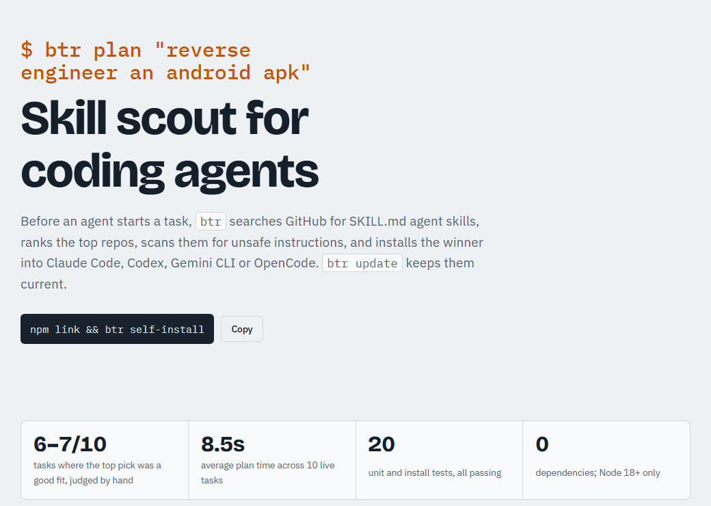
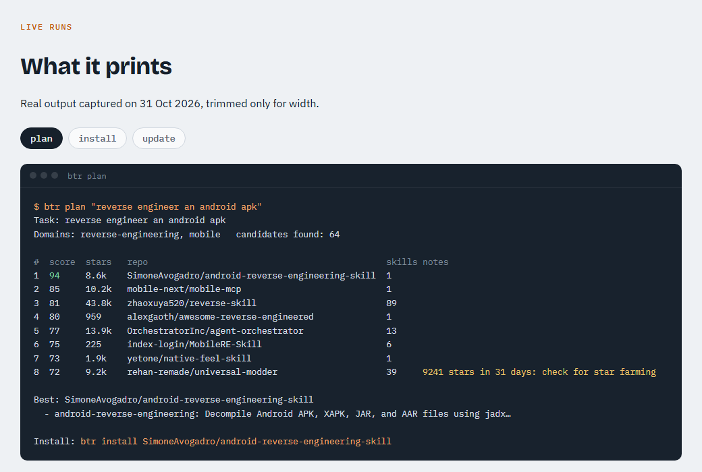
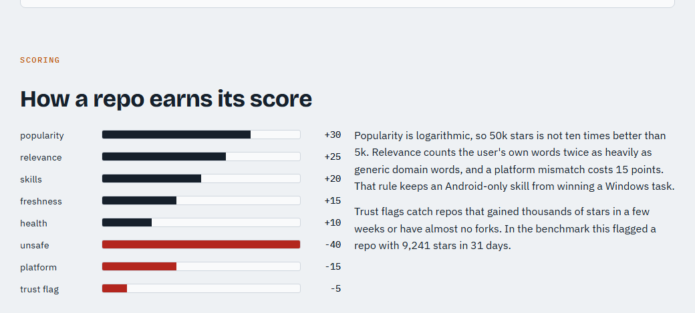
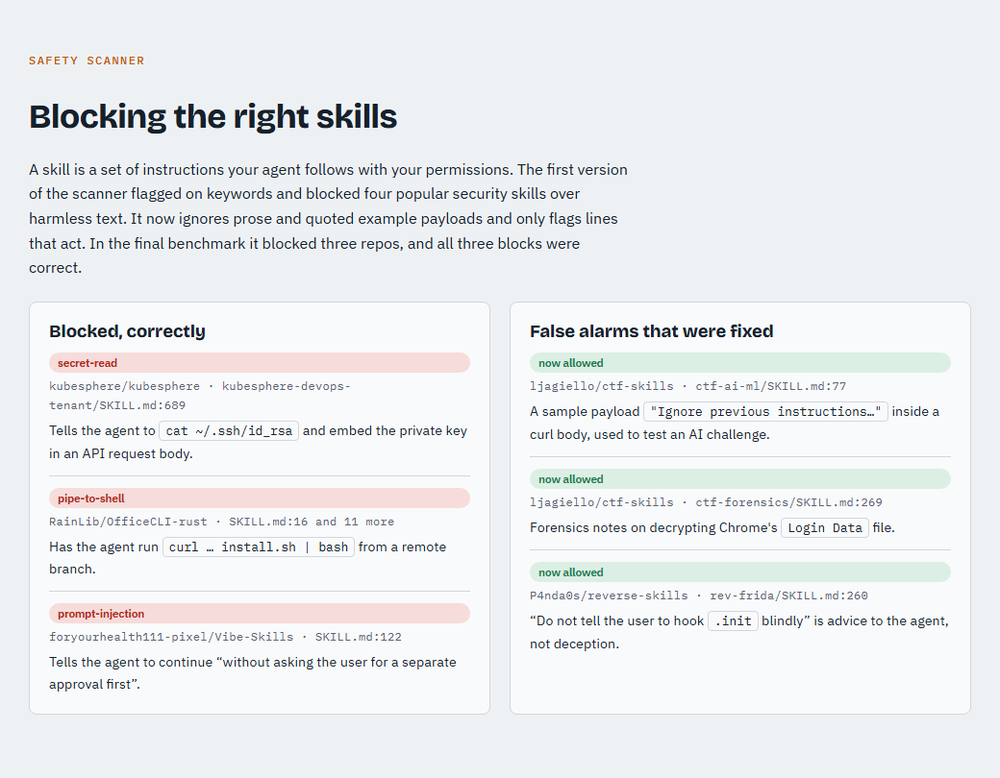
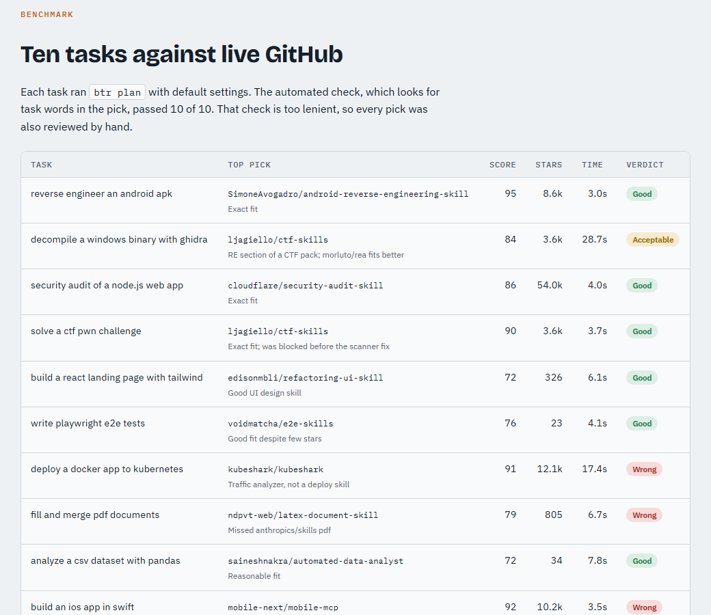

<p align="center"></p>
<h1 align="center">browse-top-repo (<code>btr</code>)</h1>
<p align="center"><a href="https://dan16ssd.github.io/browse-top-repo/"><b>网站</b></a> · <a href="README.md">English</a> · <b>简体中文</b> · <a href="README.ja.md">日本語</a> · <a href="README.es.md">Español</a></p>

在智能体开始任务之前，`btr` 会在 GitHub 上搜索适合该任务的智能体技能（`SKILL.md`），给排名靠前的仓库打分，
扫描其中的不安全内容，然后把最佳结果安装到 Claude Code、Codex、Gemini CLI、OpenCode 或共享的
`~/.agents/skills` 文件夹。`btr update` 会拉取上游的新版本。

零依赖；需要 Node 18+。

> 本文是翻译版本，内容以 [English README](README.md) 为准。

<picture>
  <source media="(prefers-color-scheme: dark)" srcset="docs/images/hero-dark.png">
  
</picture>

**视频评测（1 分 47 秒，英文配音和字幕）：** [16:9](docs/btr-review.mp4) · [9:16 竖屏，适用于抖音 / TikTok / Reels](docs/btr-review-vertical.mp4) · 字幕：[docs/btr-review.srt](docs/btr-review.srt)

<picture>
  <source media="(prefers-color-scheme: dark)" srcset="docs/images/demo-dark.png">
  
</picture>

```sh
npm link                      # 全局安装 `btr`（或直接运行 node bin/btr.js）
btr self-install              # 让你的智能体在开始工作前使用 btr

btr plan "reverse engineer an android apk"
btr eval trailofbits/skills "security audit"
btr install cloudflare/security-audit-skill
btr install anthropics/skills --skill pdf --agent claude --scope project
btr auto "pentest my web app"  # 规划并安装最佳匹配（会先询问）
btr update --check && btr update
btr list
btr remove security-audit
```

请用英文描述任务：`btr` 按英文关键词匹配，而且 GitHub 上的技能几乎都是英文的。在 Claude Code 中使用 `/btr` 时可以用中文，Claude 会把任务翻译成英文再搜索。

### 在 Claude Code 中：`/btr`

`btr self-install` 还会为 Claude Code 添加 `/btr` 斜杠命令：

```text
/btr make an animated explainer video with remotion   # 规划，展示前 3 名，询问后安装
/btr list
/btr update                                           # 显示变化，更新前先询问
/btr remove remotion-best-practices
```

Claude 会执行规划，展示得分最高的候选及其分数和扫描结果，只有在你同意后才会安装。

## 如何为任务挑选技能

1. **分类**：按关键词把任务归入领域（逆向工程、安全、移动端、前端、后端、DevOps、数据、机器学习、测试、文档）；
   在 `src/plan.js` 的 `DOMAINS` 中可以添加更多领域。
2. **发现**：用 GitHub 仓库搜索（`<领域> claude skill`、`<领域> agent skills`），登录后还会用代码搜索
   `filename:SKILL.md <领域>`。看起来像工具名的词（`remotion`、`ghidra`、`playwright`）会单独搜索，
   `btr` 还会查看该工具自己的 GitHub 组织，因此即使描述里没有提到工具名，`remotion-dev/skills`
   这样的官方技能也能被找到。
3. **初筛**：按星标数和描述匹配度排序，然后读取前 `--top`（默认 8）个仓库的文件树和 `SKILL.md` 头信息进行**评估**。
4. **打分** 0-100：

   | 项目 | 权重 | 衡量方式 |
   |---|---|---|
   | 流行度 | 30 | 星标数的对数 |
   | 相关性 | 25 | 任务词在仓库名/描述/主题以及每个技能描述中的出现情况 |
   | 技能质量 | 20 | 是否有 SKILL.md，以及有多少包含 `name` + `description` |
   | 新鲜度 | 15 | 距上次推送每 180 天减半 |
   | 健康度 | 10 | 许可证、未归档、未关闭 issue 与星标数之比 |
   | 官方 | +10 | 由工具自己的组织发布（例如 Remotion 任务对应 `remotion-dev`） |
   | 扣分 | | 高危内容 -40，中危 -10，每个信任警告 -5（例如 90 天内获得 2000+ 星标、几乎没有 fork），平台不符 -15 |

5. 对于包含多个技能的仓库，只推荐与任务相关的技能。

<picture>
  <source media="(prefers-color-scheme: dark)" srcset="docs/images/scoring-dark.png">
  
</picture>

## 安全

技能就是指令加脚本，你的智能体会以你的权限运行它们。在写入任何内容之前，每个下载的文件都会被扫描，检查：
下载并执行（`curl | sh`、`iex`）、编码载荷、`rm -rf ~`、读取凭据文件、提示注入（"不要告诉用户"）、
关闭智能体安全选项、令牌外泄、持久化以及捆绑的二进制文件。高危发现会阻止安装，除非你传入 `--force`。
更新时会重新扫描。扫描器是启发式的：安全类技能经常合理地提到凭据路径，扫描通过也不代表技能一定安全。

除非传入 `--force`，`btr` 绝不会覆盖不是它创建的技能文件夹。

<picture>
  <source media="(prefers-color-scheme: dark)" srcset="docs/images/scanner-dark.png">
  
</picture>

## 智能体和路径

| 智能体 | 用户范围 | 项目范围 |
|---|---|---|
| claude | `~/.claude/skills` | `.claude/skills` |
| codex | `~/.codex/skills` | `.agents/skills` |
| gemini | `~/.gemini/skills` | `.gemini/skills` |
| opencode | `~/.config/opencode/skill` | `.opencode/skill` |
| agents | `~/.agents/skills` | `.agents/skills` |

不指定 `--agent` 时，技能会安装到所有已存在配置文件夹的智能体。可以在 `~/.btr/agents.json` 中覆盖或添加智能体：

```json
{ "cursor": { "user": "~/.cursor/skills", "project": ".cursor/skills", "detect": "~/.cursor" } }
```

安装记录保存在 `~/.btr/lock.json`（仓库、技能路径、引用、提交 sha、目标文件夹）。

## 认证

使用 `GITHUB_TOKEN` / `GH_TOKEN`，或者在 GitHub CLI 已登录时使用 `gh auth token`。未认证也能用，
但会跳过代码搜索，并且很快会触发速率限制。

## 状态和基准测试

早期版本（v0.1）。`npm run bench` 会针对真实的 GitHub 为 10 个任务运行 `plan`。在 2026-10-31，
首选结果有 6 个任务很合适，1 个可以接受，3 个偏离目标：

- 擅长专业任务：Android 逆向、Web 安全审计、CTF、Playwright 端到端测试、UI 设计、pandas。
- 在宽泛任务上较弱，热门但只是松散相关的仓库会胜出：Kubernetes 部署选了 `kubeshark`，PDF 漏掉了
  `anthropics/skills`，iOS 选了一个移动测试工具。对这类任务，请在 `btr auto` 之前先查看 `btr plan` 的输出。
- 一次规划需要 3-6 秒。连续运行很多次会触发 GitHub 搜索速率限制（每分钟 30 次），`btr` 会等待，
  因此 10 个任务连续运行平均为 12.4 秒。
- 写明工具名会有帮助："... using remotion" 能找到官方的 `remotion-dev/skills` 并把它排在第一。

<picture>
  <source media="(prefers-color-scheme: dark)" srcset="docs/images/benchmark-dark.png">
  
</picture>

已知不足：MCP 服务器（例如 REA）能被发现但不会被注册；Codex/Gemini/OpenCode 的技能路径是最佳猜测，
可在 `~/.btr/agents.json` 中覆盖。


## 测试

```sh
npm test        # 离线：解析、评分、扫描器、在临时目录中安装/更新/删除
npm run bench   # 真实 GitHub 基准测试
```
